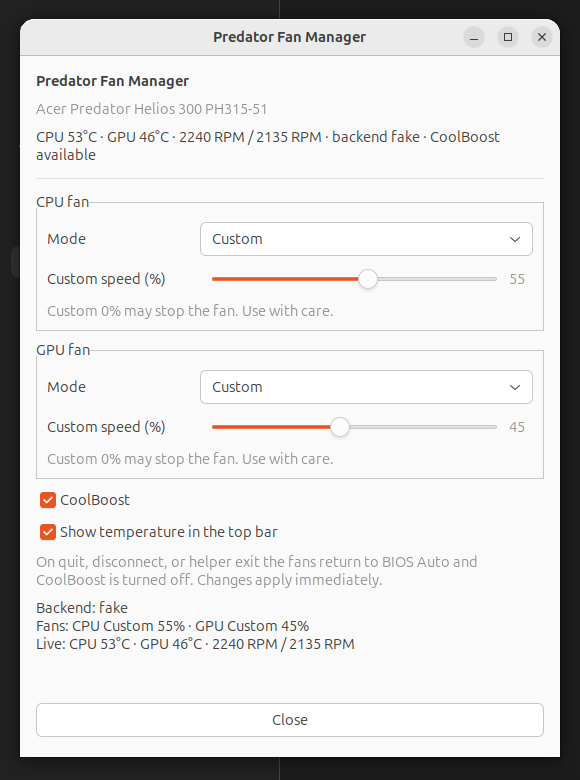
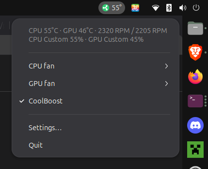

# Predator Helios 300 Fan Manager (for PH315-51)

A small Ubuntu/GNOME top-bar fan manager for the **Acer Predator Helios 300
PH315-51** (2018, i7-8750H + GTX 1060). It mirrors the fan controls of Acer
PredatorSense:

- **CPU fan**: Auto / Max / Custom speed
- **GPU fan**: Auto / Max / Custom speed
- **CoolBoost** on/off
- Live CPU/GPU temperatures and fan RPM
- Top-bar indicator coloured by the hottest sensor

The default sensor thresholds are green below 70°C, yellow from 70°C to below
85°C, and red at 85°C or above.

## Screenshot

 


## Important hardware warning

This project targets one exact machine. It uses the Acer BIOS
`AcerGamingFunction` WMI interface and, for CoolBoost/fallback, the tested EC
registers for the PH315-51.

The protocol was taken from the MIT-licensed
[marcedpr45/PredatorSense-PH315-51](https://github.com/marcedpr45/PredatorSense-PH315-51)
project, which documents live testing on this model. The fan-control app here
was not run on physical PH315-51 hardware while it was written, so **run the
read-only probe before enabling control**:

```sh
sudo predator-probe
```

It prints temperatures, RPM, EC modes and CoolBoost without changing anything.
If it does not report a working backend, do not force the app.

## Install

Dependencies on Ubuntu:

```sh
sudo apt install python3-gi gir1.2-gtk-3.0 gir1.2-ayatanaappindicator3-0.1 \
    acpi-call-dkms
```

`acpi-call-dkms` requires kernel headers and may require enrolling a MOK key
when Secure Boot is enabled. If Secure Boot blocks `acpi_call`, the EC fallback
can still control the fans, but CoolBoost and RPM monitoring may be reduced.

Then:

```sh
sudo ./install.sh
sudo predator-probe
predator-fan-manager --show
```

The installer:

- verifies the DMI model is PH315-51;
- loads `acpi_call` and `ec_sys write_support=1`;
- installs a root helper service and a user-facing tray app;
- creates an XDG autostart entry;
- refuses to install when neither fan interface is available.

The existing systemd modules configuration is left in place. The app does not
modify or disable any Acer firmware service.

## Controls

| Fan mode | Behaviour |
|---|---|
| **Auto** | Hands the fan back to BIOS firmware control. |
| **Max** | Requests maximum fan speed. |
| **Custom** | Applies the selected 0–100% speed. |

CPU and GPU are independent. CoolBoost is available when `ec_sys` is present.

Changes apply immediately. On quit, helper disconnect, or helper exit, both
fans return to **Auto** and CoolBoost is turned off.

Custom 0% can stop a fan. It is available because PredatorSense offers it, but
use it carefully under load.

## Architecture

```
predator-fan-manager (GTK tray app, normal user)
        │ Unix socket, peer-UID checked
        ▼
predator-fan-helper (root systemd service)
        ├─ WMI AcerGamingFunction via acpi_call
        ├─ EC via ec_sys (CoolBoost, fallback)
        └─ coretemp / nvidia-smi / acer hwmon fallbacks
```

Only the helper touches hardware. The GUI never runs as root.

Control socket: `/run/predator-fan-manager/control.sock`

## Files

| Path | Purpose |
|---|---|
| `/usr/local/bin/predator-fan-manager` | tray app launcher |
| `/usr/local/bin/predator-probe` | read-only hardware probe |
| `/usr/local/lib/predator-fan-manager/` | Python sources |
| `/etc/systemd/system/predator-fan-helper.service` | privileged helper |
| `~/.config/predator-fan-manager/config.json` | GUI settings |
| `~/.config/autostart/predator-fan-manager.desktop` | login autostart |

## WMI/EC details

- ACPI object: `\_SB.PCI0.WMID.WMBH`
- Methods: `SetGamingFanBehavior` 14, `SetGamingFanSpeed` 16,
  `GetGamingSysInfo` 5
- Fan modes: auto = 1, max = 2, custom = 3
- CPU/GPU bitmaps: CPU `0x1`, GPU `0x8`
- Custom speed fan IDs: CPU `0x1`, GPU `0x4`
- EC fallback and CoolBoost registers are the PH315-51 values documented by
  the reference project above.

Wrong method IDs or EC writes can affect firmware state. The helper is guarded
by exact model name, validates 0–100% speed, serializes all ACPI calls, and
restores Auto when control is released.

## Troubleshooting

```sh
sudo predator-probe
journalctl -u predator-fan-helper -f
```

- **`/proc/acpi/call` missing**: install `acpi-call-dkms`, check Secure Boot,
  and reboot.
- **Model unsupported**: this build refuses to write to a different laptop.
- **Helper unavailable**: `sudo systemctl status predator-fan-helper`.
- **CoolBoost missing**: `ec_sys` is not loaded with write support or the EC
  debug interface is unavailable.

## Development

The helper has a simulated hardware mode, useful for UI work without root or
the laptop:

```sh
./predator-fan-helper --fake --socket /tmp/predator-fan.sock &
PREDATOR_FAN_SOCKET=/tmp/predator-fan.sock ./predator-fan-manager --show
```

Unit-style protocol checks:

```sh
python3 -m py_compile core.py predator-fan-helper predator-fan-manager predator-probe
```

## Credits

- Fan/EC protocol and PH315-51 behavior:
  [marcedpr45/PredatorSense-PH315-51](https://github.com/marcedpr45/PredatorSense-PH315-51)
  (MIT).
- Earlier reverse engineering: [mohsunb/PredatorSense](https://github.com/mohsunb/PredatorSense).
- Acer PredatorSense protocol research:
  [code-hartle-tech/alien](https://github.com/code-hartle-tech/alien).
- Nearby Acer fan profiles and EC concepts:
  [nbfc-linux](https://github.com/nbfc-linux/nbfc-linux).

This project is not affiliated with or endorsed by Acer. Predator and
PredatorSense are trademarks of Acer Inc.
